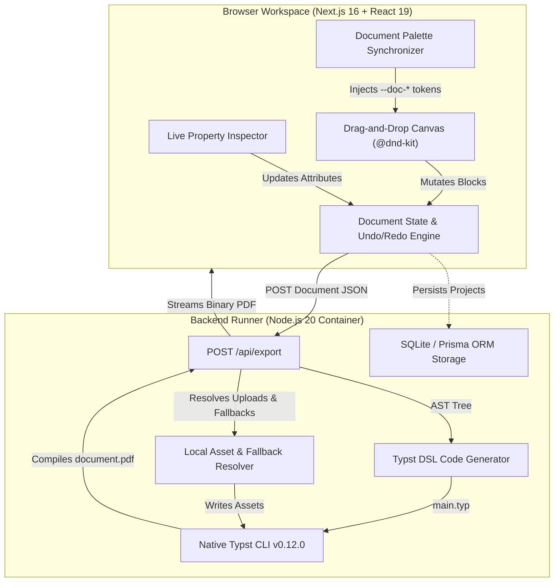

<div align="center">

# 📑 Typst Studio

**A visual document engineering studio powered by the [Typst](https://typst.app) typesetting engine.**

[](https://github.com/Abdo30004/typst-studio/actions)
[](LICENSE)
[](https://typst.app)
[](https://nextjs.org)
[](https://www.typescriptlang.org)
[](https://tailwindcss.com)
[](https://vitest.dev)

<p align="center">
  Combine the intuitive visual layout editing of Notion and Canva with the mathematical precision, sub-second compilation, and typographical elegance of Typst.
</p>

</div>

---

## 🌟 Key Highlights

- **Dual-Engine Synchronization**: Edit with an instant live DOM/CSS interactive sheet canvas (<16ms) that compiles cleanly into pixel-perfect, native vector PDFs via the native containerized Typst CLI.
- **Complex Multi-Slot Grid Layouts**: Generic N-column & N-row grid engine with fractional track sizing (`1fr 2fr 1fr`), custom row/column gutters, and pre-engineered presets (`image_title_image`, `split_2_1`, `hero_1_2_1`, `deck_3`, `sidebar_main`).
- **8 Specialized Publishing Blocks**: First-class support for Pull Quotes, Key-Value Specs, Milestone Timelines, Formal Signature Sign-Offs, Categorical Tags, Mathematical Equations, and Metric Progress Bars.
- **Decoupled Theming Architecture**: Complete separation of **Studio Workspace UI Themes** (Modern Dark, Cyberpunk Neon, Nord Frost, Solarized Warm, Editorial Paper, Monokai Pro) from **Document Color Palettes** (Classic Blue, Editorial Emerald, Warm Amber, Nordic Indigo, Crimson Velvet, Monochrome Slate, Sunset Coral, Deep Purple) with dynamic CSS custom property injection.
- **Resilient Asset Pipeline**: Automatic local asset resolution, image caching, and graceful SVG vector fallbacks for broken external images so PDF compilation never fails.
- **Undo / Redo History Stack**: Full keyboard shortcut navigation (`Ctrl+Z` / `Ctrl+Y`) with snapshot state management.
- **Live Typst Code Drawer**: Slide-over drawer with instant syntax-highlighted `.typ` code inspection, one-click copy, and file download.

---

## 🏗️ Architecture Overview



---

## 🧩 Publishing Components

| Component | Description | Typst Compilation Equivalent |
| :--- | :--- | :--- |
| **Grid Layout** | N-track multi-slot container with presets | `#grid(columns: (...), column-gutter: 12pt, ...)` |
| **Pull Quote** | Editorial quote block with author attribution | `#rect(stroke: (left: 3pt + rgb(...)))[ ... ]` |
| **Key-Value Specs** | Clean 2-column parameter/spec table | `#grid(columns: (auto, 1fr), ...)` |
| **Timeline** | Chronological event sequence with step badges | `#rect(stroke: (left: 2pt + rgb(...)))[ ... ]` |
| **Signatures** | Dual-party sign-off block with titles and dates | `#grid(columns: (1fr, 1fr))[ #line() ... ]` |
| **Tags** | Horizontal categorical badge cloud | `#box(radius: 99pt, fill: rgb(...))[ ... ]` |
| **Math** | Display and inline mathematical formulas | `$ integral_0^infinity e^(-x^2) dif x $` |
| **Progress Bar** | Percentage fill indicator with custom height | `#rect(fill: luma(230))[ #place(rect(...)) ]` |
| **Cards & Callouts** | Semantic alert containers (Note, Tip, Warning) | `#rect(radius: 4pt, fill: ...)` |
| **Data Tables** | Interactive tables with CSV upload support | `#table(columns: (...), ...)` |

---

## 🚀 Quickstart with Docker

The fastest way to experience Typst Studio is with Docker Compose:

```bash
# 1. Clone repository
git clone https://github.com/Abdo30004/typst-studio.git
cd typst-studio

# 2. Build and launch services
docker compose up --build -d
```

Open **http://localhost:3000** in your browser.

- Project data is persisted automatically to `./data/typst-builder.db`.
- Uploaded media is persisted to `./uploads/`.

---

## 💻 Local Development Setup

### Prerequisites
- Node.js 20 or higher
- [Typst CLI v0.12.0](https://github.com/typst/typst/releases) installed in your PATH

### Installation
```bash
# Install dependencies
npm install

# Initialize local SQLite database
npx prisma generate
npx prisma db push

# Run unit and integration tests
npm test

# Start Next.js development server
npm run dev
```

The dev server will be listening at **http://localhost:3000**.

---

## 🧪 Testing & Verification

Typst Studio includes a comprehensive automated test suite:

```bash
# Run Vitest unit & integration tests (27 passing tests)
npm test

# Run TypeScript typechecker
npx tsc --noEmit

# Run Playwright End-to-End browser tests
npm run test:e2e
```

---

## 📚 Detailed Documentation

Comprehensive technical guides are available in the [`./docs`](./docs) directory:

- [**System Architecture**](./docs/ARCHITECTURE.md): Dual-engine mechanics, AST design, and PDF compilation lifecycle.
- [**Layouts & Publishing Blocks**](./docs/LAYOUTS_AND_BLOCKS.md): Grid engine, presets, and element schema reference.
- [**Themes & Color Palettes**](./docs/THEMES_AND_PALETTES.md): Workspace UI themes vs. document palettes and CSS synchronizer.
- [**API Reference**](./docs/API_REFERENCE.md): REST endpoints for export, asset uploads, and project persistence.
- [**Production Deployment**](./docs/DEPLOYMENT.md): Production container setup, Nginx reverse proxy, and environment variables.

---

## 📄 License

This project is licensed under the terms of the **MIT License**.  
Copyright © 2026 **Yahiaoui Abderrahmane**. All rights reserved. See [LICENSE](LICENSE) for details.
