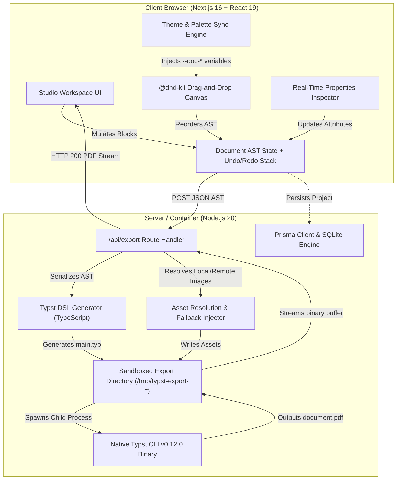

# System Architecture & Technical Design

Typst Studio is an open-source visual document engineering platform. It merges the intuitive editing experience of Notion and Figma with the typographical power, speed, and mathematical rigor of [Typst](https://typst.app).

---

## 1. High-Level System Architecture

Typst Studio operates on a **Dual-Engine Architecture**:
1. **Interactive Client Engine (DOM/CSS Canvas)**: Renders instant (<16ms) interactive previews with inline WYSIWYG editing, drag-and-drop reordering, contextual action toolbars, and synchronized CSS custom properties.
2. **Serverless & Containerized Native Typst Engine**: A sandboxed Linux subprocess runner executing `typst compile` against generated `.typ` source files with resolved local assets, producing publication-grade vector PDFs.



---

## 2. Document Abstract Syntax Tree (AST)

Documents are represented as a normalized, tree-structured JSON AST defined in [src/types/document.ts](file:///src/types/document.ts).

### Schema Hierarchy
```typescript
export interface TypstDocument {
  id: string;
  title: string;
  description?: string;
  page: PageSettings;          // Paper size, orientation, margins, columns
  theme: DocumentTheme;        // Active color palette & font pairings
  blocks: TypstBlock[];        // Linear and nested block tree
  metadata: DocumentMetadata;
}
```

### Block Structure
Every block adheres to a universal interface allowing recursive nesting:
```typescript
export interface TypstBlock {
  id: string;                  // UUIDv4
  type: BlockType;             // e.g. 'grid_layout', 'card', 'quote', 'timeline', etc.
  content?: string;            // Textual content or formula
  metadata?: Record<string, any>; // Block-specific typed properties
  children?: TypstBlock[];     // Nested children for containers
  gridPreset?: GridLayoutPreset; // Selected preset for grid_layout
}
```

---

## 3. Dual-Engine Synchronization

A critical architectural achievement is the strict visual synchronization between the DOM canvas preview and the native Typst PDF output:

| Attribute | Interactive Canvas Engine (DOM/CSS) | Typst Compilation Engine (Native CLI) |
| :--- | :--- | :--- |
| **Color System** | CSS custom properties (`var(--doc-primary)`, `var(--doc-surface)`) | Hex to RGB mapping: `rgb("#0284c7")` |
| **Grid System** | CSS Grid (`grid-template-columns: repeat(...)`) | Typst Grid: `#grid(columns: (1fr, 2fr), gutter: 12pt, ...)` |
| **Typography** | Inter, JetBrains Mono, Source Serif 4 | Native OS / Docker font packages (`Liberation`, `DejaVu`) |
| **Spacing & Gutters** | Dynamic Tailwind / inline rem-to-pt mapping | Native Typst points (`pt`, `em`, `fr`) |
| **Images & Media** | Direct web URL / Object URL rendering | Local file resolution with SVG vector fallback |

---

## 4. Compilation & Export Pipeline

When a user triggers **Export PDF**, the following execution sequence occurs:

1. **Serialization**: The current document AST is sent via `POST /api/export`.
2. **Directory Isolation**: A dedicated temporary directory (`os.tmpdir()/typst-export-${uuid}`) is provisioned.
3. **Asset Gathering**:
   - Any uploaded images referenced via `/uploads/...` are resolved from `./public/uploads` and copied to the export directory.
   - External URLs are either cached or replaced with an inline, robust SVG placeholder if unreachable.
4. **DSL Generation**: [src/lib/typst/generator.ts](file:///src/lib/typst/generator.ts) converts the AST into clean, idiomatic `.typ` markup.
5. **Compilation Subprocess**:
   - Executes: `typst compile main.typ document.pdf --font-path /usr/share/fonts`
   - Strict timeout: 15,000ms.
6. **Streaming & Cleanup**: The generated PDF binary is read into a Node buffer, the temporary directory is purged, and the response is streamed with headers:
   - `Content-Type: application/pdf`
   - `Content-Disposition: attachment; filename="document.pdf"`

---

## 5. Security & Isolation

- **Sandboxing**: The Typst CLI executes as an unprivileged process inside a lightweight container (`node:20-bookworm-slim`).
- **File System Protection**: Typst CLI does not have arbitrary write permissions outside its sandboxed temporary export directory.
- **Resource Constraints**: Docker memory limits (default 1GB) and CPU quotas prevent denial-of-service via infinite recursive macro expansions.
