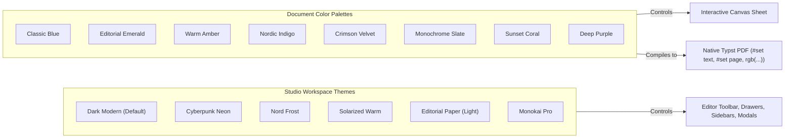

# Themes & Document Color Palettes

Typst Studio implements a strict, decoupled theming architecture that cleanly separates **Workspace Studio UI Themes** from **Document Publishing Palettes**.

---

## 1. Architectural Separation

In document authoring tools, mixing application chrome styles with document styling causes visual distortion. Typst Studio separates them into two isolated systems:



---

## 2. Studio Workspace Themes

Controls the look and feel of the code editor, toolbars, property drawers, and background canvas backing:

| Theme Key | Name | Mode | Primary Color | Aesthetic Target |
| :--- | :--- | :--- | :--- | :--- |
| `dark` | **Modern Dark** | Dark | `#3b82f6` (Blue) | Neutral zinc interface with high contrast. |
| `cyberpunk` | **Cyberpunk Neon**| Dark | `#f43f5e` (Neon Pink)| High-energy vibrant neon accents on pitch black. |
| `nord` | **Nord Frost** | Dark | `#88c0d0` (Arctic Ice)| Calming Arctic blues and pastel slate. |
| `solarized` | **Solarized Warm** | Dark | `#b58900` (Amber) | Low-contrast ergonomic warm tones. |
| `light` | **Editorial Paper** | Light | `#0284c7` (Sky) | Crisp bright desktop with subtle paper shadows. |
| `monokai` | **Monokai Pro** | Dark | `#a6e22e` (Lime Green)| Developer-centric palette with vivid syntax hues. |

---

## 3. Document Publishing Palettes

Document palettes dictate the typographical and visual color scheme of the generated document sheet (both in the live canvas and in the compiled PDF):

| Palette Key | Name | Primary Accent | Secondary | Surface Fill | Text Color |
| :--- | :--- | :--- | :--- | :--- | :--- |
| `blue` | **Classic Blue** | `#0284c7` | `#0369a1` | `#ffffff` | `#0f172a` |
| `emerald` | **Editorial Emerald** | `#059669` | `#047857` | `#fcfdfc` | `#064e3b` |
| `amber` | **Warm Amber** | `#d97706` | `#b45309` | `#fffbeb` | `#451a03` |
| `indigo` | **Nordic Indigo** | `#4f46e5` | `#4338ca` | `#faf5ff` | `#1e1b4b` |
| `crimson` | **Crimson Velvet** | `#e11d48` | `#be123c` | `#fff1f2` | `#4c0519` |
| `slate` | **Monochrome Slate** | `#334155` | `#1e293b` | `#f8fafc` | `#0f172a` |
| `coral` | **Sunset Coral** | `#f97316` | `#ea580c` | `#fff7ed` | `#431407` |
| `purple` | **Deep Purple** | `#9333ea` | `#7e22ce` | `#faf5ff` | `#2e1065` |

---

## 4. CSS Variable Injection Engine

When a document palette is selected or edited, [src/lib/theme/palette-sync.ts](file:///src/lib/theme/palette-sync.ts) injects scoped CSS Custom Properties onto the interactive document canvas container (`.typst-sheet-container`):

```css
.typst-document-sheet {
  --doc-primary: #0284c7;
  --doc-secondary: #0369a1;
  --doc-accent: #38bdf8;
  --doc-bg: #ffffff;
  --doc-surface: #f8fafc;
  --doc-text: #0f172a;
  --doc-muted: #64748b;
  --doc-border: #e2e8f0;
}
```

Components use these tokens to ensure instantaneous, lossless preview:
```tsx
<div style={{ backgroundColor: 'var(--doc-surface)', borderColor: 'var(--doc-border)' }}>
  <h2 style={{ color: 'var(--doc-primary)' }}>{title}</h2>
</div>
```

---

## 5. Typst DSL Color Translation

The Typst generator serializes the document palette directly into Typst's native `#set` rules and functional parameters:

```typst
// Document Palette Injected Styles
#set page(
  paper: "a4",
  fill: rgb("#ffffff"),
  margin: (top: 2.5cm, bottom: 2.5cm, left: 2.5cm, right: 2.5cm)
)
#set text(
  font: ("Liberation Sans", "DejaVu Sans"),
  size: 10.5pt,
  fill: rgb("#0f172a")
)

// Accent and Border Rules
#let primary-color = rgb("#0284c7")
#let secondary-color = rgb("#0369a1")
#let surface-color = rgb("#f8fafc")
#let border-color = rgb("#e2e8f0")
```

This guarantees 100% color parity between the on-screen editing canvas and the generated physical PDF.
